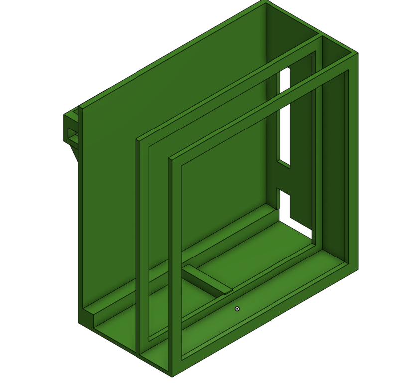

# Electronics-Hub-Halflife

This is a little project I made to organize my stuff. It has a custom XBOX Series S slot with some airflow and a space for my laptop to charge.
It also has an airpod charging station. The biggest feature is a 1 DOF panning phone arm powered by a MG996R servo. It will run on an arduino uno clone. The total print is around 1 kg of PLA.
